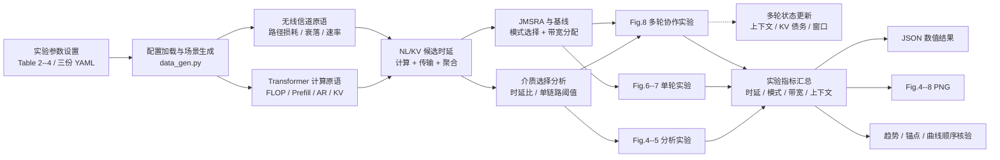
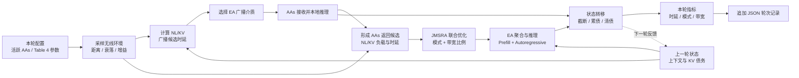
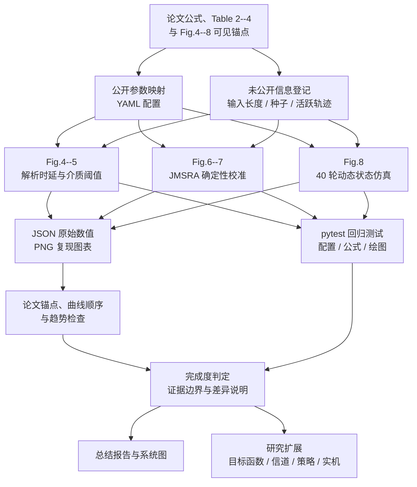

# Token/KV-Cache 多智能体协作论文复现总结报告

> 论文：*A Token/KV-Cache Communication Media Selection and Resource Allocation Strategy for Multi-Agent Collaboration*  
> 报告日期：2026-07-22  
> 复现类型：分析型数值仿真，不执行真实大模型权重

## 1. 执行摘要

本项目已经完成论文数值实验范围内的**完整分析型复现**：实现 Transformer/LLaMA-7B 推理时延原语、无线传输时延、NL Token 与 KV-Cache 双介质选择、JMSRA 联合介质选择与带宽分配，以及 40 轮动态上下文和 KV 债务状态仿真；对应覆盖论文 Table 2--4 和 Fig.4--8。

复现结果与论文的主要趋势及结论一致：

- Fig.4 的 NL/KV 端到端时延比同时出现 NL 优势区和 KV 优势区，并再现 SNR、智能体数量、计算能力与负载比例变化产生的边界移动。
- Fig.5 的单链路选择阈值随 KV 债务、历史上下文、SNR 和生成长度按论文结论移动。
- Fig.6 的 JMSRA 结果接近论文公开锚点，低/高 EA 算力场景的模式结构一致。
- Fig.7 再现带宽增加降低系统时延、AA 数量增加提高系统时延的曲线趋势。
- Fig.8 的 8 项显式趋势检查全部通过，包括上下文饱和、EA 首轮使用 KV、深轮次 AA 主要使用 KV，以及 JMSRA 抑制 EA 深轮次计算开销。

完成度结论必须按证据边界理解：项目完整复现了论文公开的**分析模型、算法流程、参数化实验和结论趋势**；由于论文未公开原始随机种子、逐点拓扑样本、完整活跃 AA 轨迹及 Fig.4(b) 输入长度，不能声称逐像素或逐点原始数据复现。项目中的 LLaMA-7B 是分析型参数模型，**不加载模型权重**，不评估语义质量，也不代表真实推理服务部署。

## 2. 论文方法与系统角色

论文研究一个主智能体 EA（Edge Agent）与多个辅助智能体 AA（Assistant Agent）协作时的通信和计算时延。每次协作传输可以选择：

- **NL 模式**：发送自然语言 Token。传输负载小，但接收方需要重新执行 Prefill 计算。
- **KV 模式**：发送 Transformer KV-Cache。可减少接收方 Prefill，但传输负载更大，并受历史上下文与 KV 债务窗口影响。

系统需要同时处理两类决策：EA 到多个 AA 的广播链路选择 NL 或 KV；多个 AA 返回 EA 时，JMSRA 为每个 AA 联合选择介质和带宽比例，使最慢链路和聚合计算形成的端到端时延最小。多轮场景还维护 EA/AA 上下文长度、KV 债务、上下文上限和债务清理窗口。

## 3. 复现范围与证据等级

| 论文内容 | 当前实现 | 证据等级与边界 |
| --- | --- | --- |
| Table 2、Fig.4 | 完整两轮端到端 NL/KV 解析时延 | 公式与参数直接复现；Fig.4(b) 输入长度 `512` 为显式校准假设 |
| Table 2、Fig.5 | 完整单链路边际选择阈值 | 公式和定性边界直接复现 |
| Table 3、Fig.6 | JMSRA 确定性拓扑校准 | 对照论文公开时延与 KV 数量锚点；原始种子不可得 |
| Table 3、Fig.7 | 带宽和 AA 数量扫描 | 曲线顺序与趋势复现；拓扑样本使用登记的确定性种子 |
| Table 4、Fig.8 | 完整 40 轮状态机和绘图管线 | 参数、公式和趋势复现；活跃轨迹从图中推断，热图不逐点一致 |
| 真实 LLaMA-7B 推理 | 未实现 | 超出论文数值时延实验和当前复现目标 |
| 语义质量、任务成功率 | 未实现 | 需要真实模型、数据集和任务评价协议 |

因此，“完整复现”在本报告中专指论文的分析型数值系统，不扩张为真实模型端到端系统。

## 4. 系统框图

[独立高清 PNG](../results/figures/system_architecture.png) · [完整 Mermaid 源文件](diagrams/system-architecture.mmd)



实验主体代码从三份 YAML 参数开始，由 `src/utils/data_gen.py` 完成加载、校验及场景或拓扑生成。`src/models/transformer.py` 和 `src/channels/wireless_channel.py` 分别提供计算与通信原语，`src/utils/latency.py` 组合出 NL/KV 候选时延；随后分流到介质选择分析、JMSRA 单轮优化和 40 轮协作状态模型，对应 Fig.4--5、Fig.6--7 和 Fig.8 三组实验。各分支最终汇总时延、模式、带宽和上下文指标，并输出 JSON、论文图表与结论核验结果。`simulations/render_reproduction_diagrams.py` 以统一图模型生成 Mermaid 和 PNG，避免两套图件的节点与连线语义漂移。

## 5. 数据流图

[独立高清 PNG](../results/figures/data_flow.png) · [完整 Mermaid 源文件](diagrams/data-flow.mmd)



每轮输入由静态配置、活跃 AA 数量、随机信道样本和上一轮状态共同组成。EA 广播选择与 AAs 返回 JMSRA 决策使用同一轮的信道和时延候选；状态转移在本轮推理结束后统一执行，并把更新后的上下文和债务反馈到下一轮，从而形成 40 轮闭环。

## 6. 复现工作流

[独立高清 PNG](../results/figures/reproduction_workflow.png) · [完整 Mermaid 源文件](diagrams/reproduction-workflow.mmd)



工作流把“实现通过测试”和“结果符合论文”作为两个独立证据源。只有公式、配置、绘图测试通过，且数值锚点、曲线顺序和趋势检查同时满足，才形成完成度结论；无法从论文获得的信息必须进入假设登记，而不是被隐式当作论文原值。

## 7. 参数对照

### 7.1 LLaMA-7B 分析型参数

| 参数 | 值 | 用途 |
| --- | ---: | --- |
| Transformer 层数 | 32 | Prefill、Autoregressive 和 KV 体积计算 |
| 注意力头数 | 32 | FLOP/KV 参数化 |
| 每头维度 | 128 | KV 元素数量计算 |
| 隐藏维度 | 4096 | 线性层与注意力 FLOP |
| FFN 维度 | 11008 | 前馈网络 FLOP |
| 词表大小 | 32000 | 输出投影 FLOP |

这些参数来自论文 Table 2 所使用的 LLaMA-7B 架构。当前代码根据序列长度和计算能力估算 FLOP 时延，并根据层数、头数和头维度估算 KV 传输体积；它不是 Hugging Face/llama.cpp/vLLM 模型加载器，也不产生真实 Token。

### 7.2 通信与多轮参数

| 参数 | Fig.4--7 / Table 3 | Fig.8 / Table 4 |
| --- | ---: | ---: |
| Token 位宽 | 16 bit | 16 bit |
| KV 压缩比 | 2 | 2 |
| 默认带宽 | 2 GHz | 2 GHz |
| 噪声功率谱密度 | -140 dBm/Hz | -140 dBm/Hz |
| 距离 | 5--10 m | 5--10 m |
| 路径损耗 | `30 + 35 log10(d)` | `30 + 35 log10(d)` |
| AA 发射功率 | 10--23 dBm | 10--23 dBm |
| EA 算力 | 扫描 5/10/35 TFLOPS 等场景 | 20 TFLOPS |
| AA 算力 | 由实验场景给定 | 5--15 TFLOPS |
| 最大 AA 数 | Fig.7 扫描至 50 | 20 |
| 对话轮数 | 静态/单轮 | 40 |
| EA/AA 上下文上限 | 不适用 | 409600 / 51200 Token |
| EA/AA KV 债务窗口 | 不适用 | 102400 / 10240 Token |

### 7.3 显式校准项

- Fig.4(b) 输入长度：论文未披露，配置为 `512` Token，并标记 `calibration-assumption`。
- Fig.6--7 随机种子：论文未披露。项目在固定候选区间 `[0, 4999]` 内按公开锚点选择确定性种子 `1477`，不声称论文使用同一种子。
- Fig.8 随机种子：`2026`；活跃 AA 数量序列根据 Fig.8(a) 连续 Waiting 区域推断并标记 `figure-inferred-calibration`。

## 8. 实验对照

### 8.1 Fig.4：端到端 NL/KV 时延比

`results/logs/paper_mode_analysis.json` 中与 Fig.4 对应的 5 项检查全部为真：

| 检查 | 结果 | 对应论文趋势 |
| --- | --- | --- |
| `fig4_a_nonmonotonic` | 通过 | 负载比例变化产生非单调时延比 |
| `fig4_b_homogeneous_moves_toward_nl` | 通过 | 同构计算能力提高时，选择向 NL 区域移动 |
| `fig4_c_increases_with_snr` | 通过 | SNR 提高改变 KV 大负载传输代价和介质边界 |
| `fig4_d_increases_with_aa_count` | 通过 | AA 数量增加放大协作路径时延 |
| `fig4_has_nl_and_kv_regions` | 通过 | 参数空间内同时存在 NL/KV 优势区 |

结果图：[Fig.4 时延比](../results/figures/paper_fig4_latency_ratio.png)。

### 8.2 Fig.5：单链路模式选择阈值

Fig.5 的 5 项检查全部为真：得分随带宽比例 `rho` 增加；KV 债务 `xi` 增大提高选择阈值；历史上下文 `theta` 增大降低阈值；SNR 增大降低阈值；生成长度 `alpha` 增大降低阈值。

以 `alpha=512`、SNR 5 dB 为例，`theta=0` 时阈值随 `xi=0/3000/6000` 从 `0.0127`、`0.1586` 增至 `0.4154`；当 `theta=10000` 时对应阈值降为 `0.0078`、`0.0889`、`0.2157`。这与论文关于历史上下文和 KV 债务共同控制介质选择的结论一致。

结果图：[Fig.5 单链路选择](../results/figures/paper_fig5_single_link_selection.png)。

### 8.3 Fig.6：JMSRA 锚点校准

| EA 算力 | 本复现 JMSRA 时延 | 论文锚点 | 时延偏差 | 本复现 KV 数 | 论文锚点 | 数量偏差 |
| ---: | ---: | ---: | ---: | ---: | ---: | ---: |
| 5 TFLOPS | 27.5925 s | 23.5403 s | +4.0522 s | 17 | 18 | -1 |
| 35 TFLOPS | 12.5777 s | 13.0550 s | -0.4773 s | 7 | 6 | +1 |

低 EA 算力时，JMSRA 选择更多 KV 以避免 EA 重复计算；高 EA 算力时，更多 AA 可使用 NL。由于论文没有公开拓扑样本，以上属于对可见锚点的确定性校准，不是原始样本重放。

结果图：[Fig.6 路径时延](../results/figures/paper_fig6_latency_paths.png)、[5 TFLOPS 拓扑](../results/figures/paper_fig6_topology_c0_5_tflops.png)、[35 TFLOPS 拓扑](../results/figures/paper_fig6_topology_c0_35_tflops.png)。

### 8.4 Fig.7：带宽与 AA 数量扫描

- 带宽从 `0.5 GHz` 增至 `4.0 GHz` 时，JMSRA 时延从 `41.0589 s` 降至 `17.1640 s`。
- 在 `2 GHz` 下，AA 数量从 `5` 增至 `50` 时，JMSRA 时延从 `7.0002 s` 增至 `45.4610 s`。

两组扫描都再现论文曲线方向和算法相对优势。结果图：[带宽扫描](../results/figures/paper_fig7_bandwidth_scan.png)、[AA 数量扫描](../results/figures/paper_fig7_aa_count_scan.png)。

### 8.5 Fig.8：40 轮多轮协作

`results/logs/paper_multi_round.json` 的 8 项趋势检查全部通过：

| 指标 | 复现值 | 解释 |
| --- | ---: | --- |
| EA 上下文上限 | 409600 Token | 与 Table 4 一致 |
| 首次饱和轮次 | 23 | 接近论文约 400K 的饱和区域 |
| 深轮次 KV 占比 | 94.71% | AA 返回以 KV 为主 |
| 前 10 轮 NL 占比 | 20.00% | 高于深轮次 |
| 深轮次 NL 占比 | 5.29% | 随上下文增长，KV 更有利 |
| EA 第 1 轮介质 | KV | 通过 `ea_first_round_kv` |
| EA 后续 KV 占比 | 0% | 后续广播以 NL 为主 |
| Pure-NL 峰值 | 第 22 轮，231.3576 s | 与论文约第 21 轮、241 s 同量级 |
| 深轮次 Prefill 比 | 5.10% | JMSRA 显著抑制 EA Prefill |
| 深轮次总计算比 | 10.21% | JMSRA 显著抑制 EA 总计算时延 |

需要保留一项差异说明：生成热图在早期轮次仍比论文 Fig.8(a) 更偏 KV，虽然“早期 NL 占比高于深轮次”和其余核心趋势均成立。因此 Fig.8 是参数和方程对齐的**趋势复现**，不是逐格热图复现。

结果图：[Fig.8 多轮结果](../results/figures/paper_fig8_multi_round.png)。

## 9. 验证证据与运行方法

核心证据文件：

- `results/logs/paper_mode_analysis.json`：Fig.4--5 原始扫描、阈值和 10 项检查。
- `results/logs/paper_jmsra_calibration.json`：Fig.6--7 拓扑、基线、JMSRA 结果和锚点偏差。
- `results/logs/paper_multi_round.json`：40 轮完整状态、模式、带宽和 8 项趋势检查。
- `results/figures/`：论文复现图和本报告的三张系统图。
- `src/tests/`：配置、单位、时延原语、JMSRA、状态转移、脚本和绘图回归测试。

最终验收执行完整测试套件，共 `126 passed`：原复现系统 119 项测试，加上本次新增的 7 项图模型、Mermaid、PNG 和报告契约测试。

在项目根目录使用本地虚拟环境运行：

```powershell
.\.venv\Scripts\python.exe simulations\paper_mode_analysis.py
.\.venv\Scripts\python.exe simulations\plot_paper_mode_analysis.py
.\.venv\Scripts\python.exe simulations\paper_jmsra_calibration.py
.\.venv\Scripts\python.exe simulations\plot_paper_jmsra.py
.\.venv\Scripts\python.exe simulations\paper_multi_round.py
.\.venv\Scripts\python.exe simulations\plot_paper_multi_round.py
.\.venv\Scripts\python.exe simulations\render_reproduction_diagrams.py
.\.venv\Scripts\python.exe -m pytest
```

三张系统图的 Mermaid 与 PNG 均可由 `render_reproduction_diagrams.py` 命令重新生成。

## 10. 完成度判定与剩余限制

### 10.1 已完成

- 论文公开 Transformer 计算、无线传输和 NL/KV 负载公式。
- NL、KV、优化基线和 JMSRA 双向贪心搜索及带宽二分分配。
- EA 广播介质选择、多 AA 返回介质选择和 40 轮状态转移。
- Table 2--4 参数配置与 Fig.4--8 实验、原始 JSON、绘图及自动化检查。
- 未公开参数的显式登记、锚点偏差记录和复现边界说明。
- 系统框图、数据流图、复现工作流和本总结报告。

### 10.2 未完成但不影响论文数值复现结论

- 论文原始随机种子、逐点拓扑和 Fig.8 活跃 AA 原始轨迹不可获得。
- Fig.8(a) 早期热图未逐格匹配。
- 不运行真实 LLaMA-7B 权重，不覆盖 Tokenizer、采样、批处理、GPU Kernel、内存管理和真实网络栈。
- 不评价回答正确率、协作任务成功率或语义质量。

最终判定：**当前仓库可以视为论文分析型数值系统的完整复现基线，但不能视为真实 LLaMA-7B 多智能体产品系统的完整实现。**

## 11. 基于当前系统开展研究创新

当前系统足以支持以时延、通信、缓存和资源分配为核心的研究性创新，无需先实现真实 LLaMA-7B 权重执行。适合直接开展的方向包括：

1. 将单一时延目标扩展为时延、能耗、显存和公平性的多目标优化。
2. 在不完美 CSI、时变带宽、丢包或信道预测误差下研究鲁棒/在线 JMSRA。
3. 引入分层 KV 压缩、量化、稀疏化和分层缓存，联合优化压缩率与介质选择。
4. 将固定或图中推断的活跃 AA 轨迹替换为任务驱动调度、队列或学习型策略。
5. 扩展异构模型、异构上下文窗口和异构设备算力，研究跨模型协作。

只有研究问题涉及语义质量、真实 Token 生成、模型精度、GPU 内核、端侧显存峰值或真实网络协议时，才需要在当前分析系统外增加完整模型执行层。建议把真实推理作为独立验证后端接入，而不是替换现有分析模型：分析后端用于大规模参数扫描和算法消融，真实后端用于小规模外部效度验证。这样能够保留当前复现的可解释性和运行效率，同时建立从论文公式到实机观测的校准链路。
